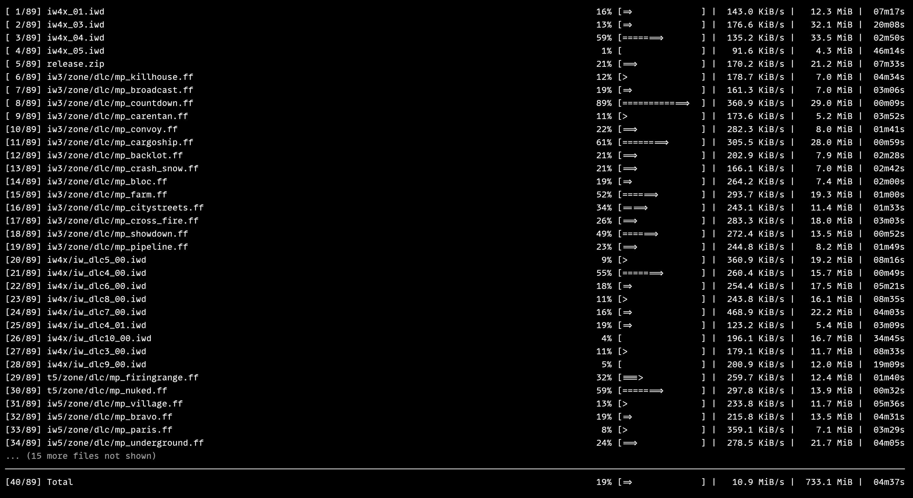

<p align="center">
  <picture>
    <source media="(prefers-color-scheme: dark)" srcset=".github/logo-dark.svg">
    
  </picture>
</p>

<h3 align="center">Launcher and updater for IW4x</h3>

<p align="center">
  <a href="https://github.com/iw4x/launcher/releases"></a>
  <a href="https://github.com/iw4x/launcher/releases"></a>
  
  <a href="LICENSE.md"></a>
  <a href="https://build2.org"></a>
</p>

<p align="center">
  <a href="#getting-started">Getting started</a> ·
  <a href="#command-line">Command line</a> ·
  <a href="#development">Development</a>
</p>



## Getting started

> [!IMPORTANT]
> The launcher requires the Steam version of Call of Duty: Modern Warfare 2
> (2009).

1. Download the archive for your platform from the
   [releases](https://github.com/iw4x/launcher/releases) page:

   | Platform | Archive                                        |
   |----------|------------------------------------------------|
   | Windows  | `launcher-<version>-x86_64-windows.zip`        |
   | Linux    | `launcher-<version>-x86_64-linux-glibc.tar.xz` |

2. Extract it into the game directory, next to `iw4mp.exe`.
3. Run `iw4x-launcher` from there. The first run downloads IW4x and asks
   which client to start. After that, use the shortcuts it installs.

## Command line

The launcher works without any options, but these come in handy.

<details>
<summary>Options</summary>

| Option                     | Description                                                    |
|----------------------------|----------------------------------------------------------------|
| `--arch x86\|x64`          | Start IW4x (`x86`) or IW4x (mm) (`x64`) without asking.        |
| `--prerelease`             | Update to pre-releases to try upcoming features.               |
| `--game-args <arg>`        | Pass an argument to the game. Repeat for several.              |
| `--skip-launch`            | Update everything but don't start the game.                    |
| `--skip-remote`            | Start the game without contacting GitHub or checking files.    |
| `--no-self-update`         | Leave the launcher itself as it is.                            |
| `--no-shortcuts`           | Leave the Steam, desktop, and menu shortcuts as they are.      |
| `--proxy <url>`            | Route all traffic through an HTTP, HTTPS, or SOCKS5 proxy.     |
| `--jobs <num>`             | Limit the number of parallel downloads.                        |
| `--force-steam-runtime`    | Run Proton inside the Steam Linux Runtime container.           |

Run `iw4x-launcher --help` for the complete list.

</details>

## Development

The development setup for `launcher` uses the standard `bdep`-based
workflow. Note that development builds regenerate the files kept in
`launcher/launcher/pregenerated/`. For this `bdep` builds the `cli` and
`odb` compilers and the `xxd` utility automatically. If you want to use
`launcher` in your `build2`-based project, then see the package
[`README.md`](launcher/README.md) file.

On Linux we build with GCC. For example:

```
git clone https://github.com/iw4x/launcher.git
cd launcher

bdep init -C @gcc cc config.cxx=g++
bdep update
bdep test
```

We can also cross-compile for Windows with MinGW-w64 GCC and run the tests
under Wine, with `WINEPATH` pointing to the directory that contains the
MinGW runtime DLLs (`/usr/x86_64-w64-mingw32/sys-root/mingw/bin` on Fedora).
For example:

```
bdep init -C @mingw cc config.cxx=x86_64-w64-mingw32-g++ \
  config.test.runner="env WINEPATH=/usr/x86_64-w64-mingw32/sys-root/mingw/bin wine"
bdep update @mingw
bdep test @mingw
```

On Windows we build with MinGW-w64 GCC from PowerShell. For example:

```
git clone https://github.com/iw4x/launcher.git
cd launcher

bdep init -C -@mingw cc config.cxx=g++
bdep update
bdep test
```

## Contributing

See [CONTRIBUTING](.github/CONTRIBUTING.md).

## License

`launcher` is licensed under the GNU General Public License, version 3 or
any later version.

See [LICENSE](LICENSE.md), [LEGAL](LEGAL), and [AUTHORS](AUTHORS).
